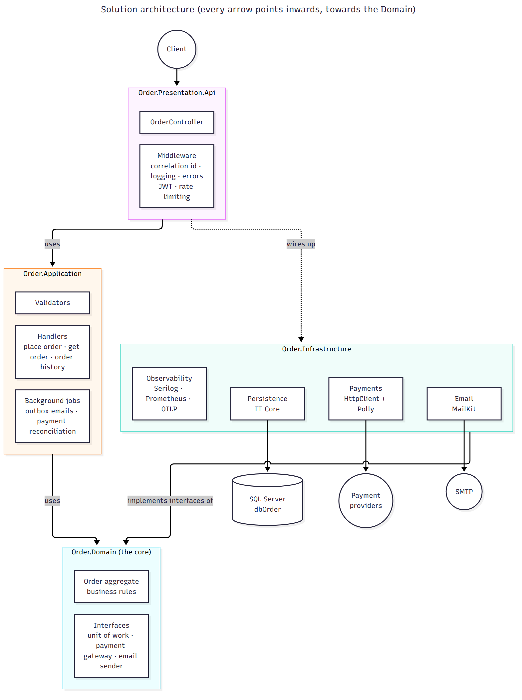
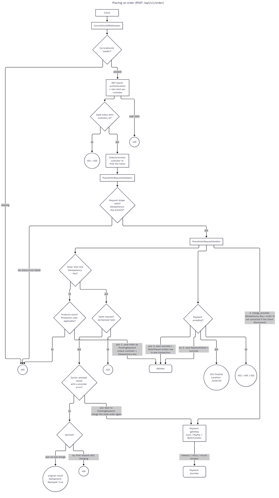
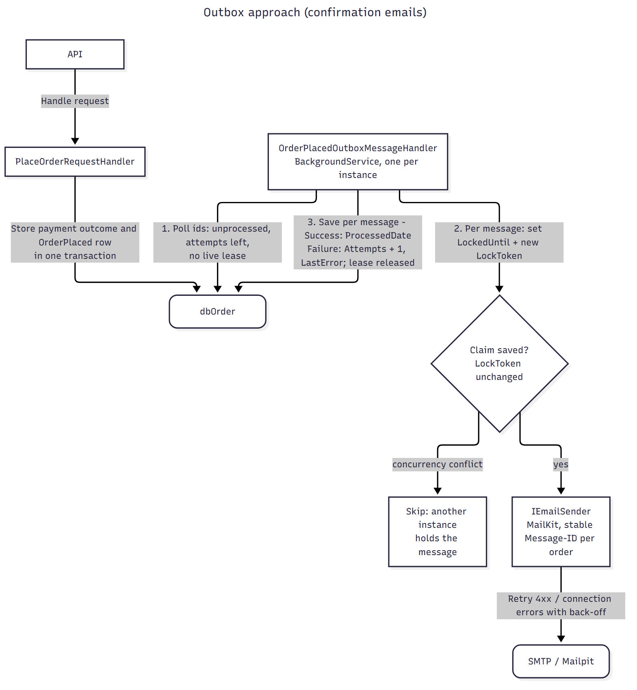
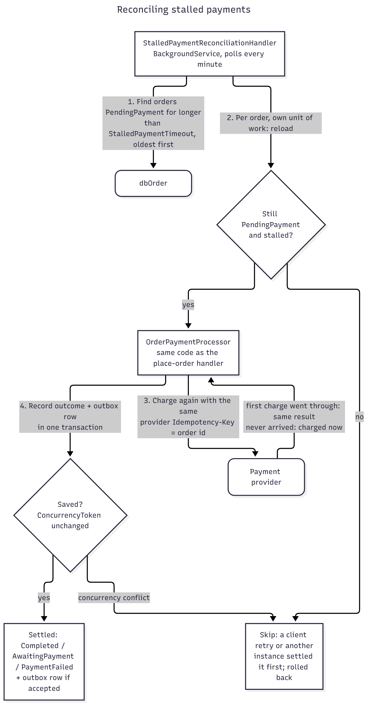
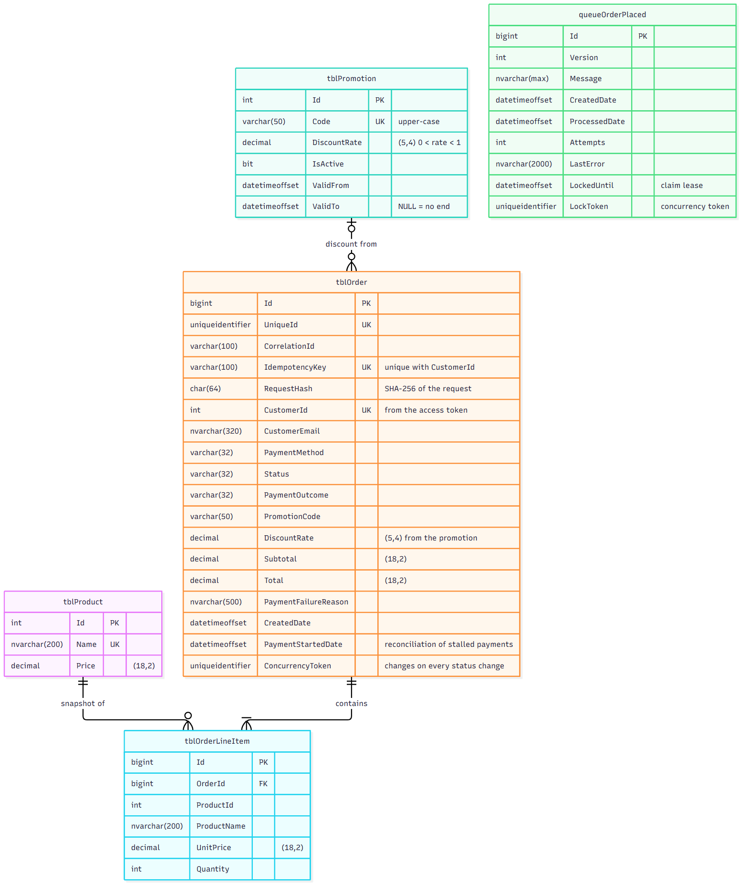

# Architecture

How the code is organised and what happens when it runs. For the reasons behind these choices, see [background.md](background.md).

**On this page:** [Layers](#layers) · [Folders](#where-things-live) · [Placing an order](#placing-an-order) · [Reading orders](#reading-orders) · [Background jobs](#background-jobs) · [Database](#database) · [Patterns used](#patterns-used) · [Tests](#tests)

## Layers



The solution follows the **onion (clean) architecture**: business rules in the middle, technology at the edges, and every dependency points inwards.

| Layer (project) | Responsibility | May reference |
|---|---|---|
| **Domain** (`Order.Domain`) | Business rules. The `Order` aggregate, the commands that change it, and the *interfaces* for things it needs from outside (unit of work, payment gateway, email sender). No database, HTTP or library code. | nothing |
| **Application** (`Order.Application`) | Use cases. One handler per request (place order, get order, order history), the background jobs, validation, and the request/response models. | Domain |
| **Infrastructure** (`Order.Infrastructure`) | Implements the Domain interfaces with real technology: EF Core + SQL Server, HTTP payment providers, SMTP, Prometheus/OpenTelemetry. | Application, Domain |
| **Presentation** (`Order.Presentation.Api`) | The ASP.NET Core host: controllers, middleware, authentication, rate limiting, and the dependency injection wiring (the *composition root*). | Application, Infrastructure |

Two things enforce this: a project can only use the projects it references (so the compiler stops `Order.Domain` from using EF Core), and `ArchitectureTests` fails if a layer's assembly references an outer layer.

## Where things live

Inside each project, every folder is also the namespace (`src/Order.Domain/Entities` is `Order.Domain.Entities`).

```
src/Order.Domain/
  Entities/          Order (aggregate root), OrderLineItem, Product, Promotion, OrderPlacedOutboxMessage
                     + DomainRuleException and the rule messages
  Commands/          CreateOrder, RecordPaymentOutcome, ...: the inputs that create or change entities
  Enums/             OrderStatus, PaymentMethods, PaymentOutcome
  Interfaces/        IPaymentGateway, IPaymentGatewayResolver, IEmailSender
  Repository/        repository interfaces + ReadModels (OrderDetail, OrderSummary) for queries
  UnitOfWork/        IUnitOfWork, IOrderUnitOfWork, IUnitOfWorkFactory + ConcurrencyConflictException
  Observability/     IObservabilityManager, metric definitions, log/response messages

src/Order.Application/
  Handlers/
    Request/V1/Commands/   PlaceOrderRequestHandler
    Request/V1/Queries/    GetOrderRequestHandler, GetCustomerOrderHistoryRequestHandler
    Payments/              OrderPaymentProcessor: charge an order and record the outcome (shared)
    Outbox/                OrderPlacedOutboxMessageHandler: background job, sends confirmation emails
    Reconciliation/        StalledPaymentReconciliationHandler: background job, settles stalled payments
    Exceptions/            exceptions that map to HTTP status codes (OrderNotFound, PaymentDeclined, ...)
  Validators/        FluentValidation rules for each request
  Models/            request/response contracts, OrderHistoryCursor, configuration classes
  Events/            the OrderPlaced event stored in the outbox
  Constants/ Helpers/ HealthCheck/

src/Order.Infrastructure/
  Persistence/       OrderDatabaseContext, table mappings, repositories, unit of work
  Payments/          Card and PayPal gateways (HTTP + Polly), BankTransfer gateway, mock provider for local runs
  Email/             SmtpEmailSender (MailKit + Polly), LogOnlyEmailSender when no SMTP host is configured
  Observability/     IObservabilityManager implementation, /metrics endpoint, OpenTelemetry

src/Order.Presentation.Api/
  Controllers/       OrderController (+ BaseController: validate → handle → respond)
  Middleware/        CorrelationIdMiddleware, RequestObservabilityMiddleware, IntermediateExceptionHandler
  Authorization/     claim names, "Customer" policy, helpers to read the customer id from the token
  Dependencies/      one *Registration class per concern (auth, rate limiting, health checks, ...)
  Program.cs         startup

src/dbOrder/         SQL scripts that create and migrate the database (see "Database" below)
```

## Placing an order

`POST /api/v1/order`



**1. Middleware** runs first, in this order:

| Step | What it does | Fails with |
|---|---|---|
| `CorrelationIdMiddleware` | Requires a `CorrelationId` header on API calls, adds it to every log line and trace, and echoes it on the response | 400 if missing |
| `RequestObservabilityMiddleware` | Logs the request and records `api.request.count` / `api.request.duration.ms` | – |
| `IntermediateExceptionHandler` | Turns exceptions thrown further in into RFC 7807 problem details with the right status code (see [api.md](api.md#status-codes)) | – |
| Authentication → rate limiting → authorization | Validates the JWT, applies the per-customer rate limit, and checks that the caller is a customer (has a `customer_id` claim) | 401, 429, 403 |

**2. `OrderController`** takes the customer id from the token (never from the body), validates the request with `PlaceOrderRequestValidator`, and passes it to the handler. A validation failure returns 400 with every invalid field listed.

**3. `PlaceOrderRequestHandler`** does the work, in one unit of work:

1. **Is this a retry?** Look for an order from this customer with the same `Idempotency-Key`.
   - Found, and the request is different → **422** (key reused).
   - Found, still being charged → **409** (in progress).
   - Found, and its payment failed with a provider error → move it back to `PendingPayment` and continue at step 4 (charge it again).
   - Found, otherwise → return the original result with `Idempotent-Replayed: true`. **No new charge.**
2. **Check references.** Load only the ordered products and the promotion. Unknown products or an invalid code → **400**, listing all problems at once.
3. **Create the `Order` aggregate** (prices from the database, discount from the promotion) and **save it as `PendingPayment`**. A unique index on (customer, idempotency key) makes a racing duplicate request fail here → **409**.
4. **Charge** through the payment gateway for the payment method (`OrderPaymentProcessor`). The order id is sent as the provider's idempotency key. The charge is *not* cancelled if the client disconnects; the gateway's own timeout still applies.
5. **Record the outcome**: the order becomes `Completed` (card / PayPal), `AwaitingPayment` (bank transfer) or `PaymentFailed`. If accepted, an `OrderPlaced` row is added to the outbox **in the same transaction**.
6. **Respond**: **201** with a `Location` header, or 402 / 409 / 503 if the payment was not accepted.

The confirmation email is *not* sent here: see [the outbox](#outbox-confirmation-emails).

## Reading orders

`GET /api/v1/order/{orderId}` and `GET /api/v1/order/by/customer/{customerId}`

Queries never load the `Order` aggregate. The repository projects straight into read models (`OrderDetail`, `OrderSummary`) with no change tracking.

- **One order:** the caller's customer id is part of the database query, so another customer's order is never even read and is reported as **404**. Support staff query without that filter.
- **Order history:** a customer can only ask for their own history (**403** otherwise). Results use **keyset paging**: the query returns `pageSize` orders older than the cursor, ordered by creation date and then row id, plus a `nextCursor` for the next page. The cursor is an opaque, URL-safe encoding of the last order's (creation date, row id).

## Background jobs

Two `BackgroundService`s run inside every API instance. Several instances can run safely at the same time.

### Outbox: confirmation emails



`OrderPlacedOutboxMessageHandler` polls `queueOrderPlaced` every 10 seconds. For each unprocessed message it:

1. **Claims** it: sets a lease (`LockedUntil`) and a new `LockToken` (a concurrency token). If another instance claimed it first, the save fails and this instance skips it.
2. **Sends** the email (MailKit, with retries). It lists each item with its quantity and price, then the subtotal, discount and total. The `OrderPlaced` event is versioned: version 2 added the items, and version 1 messages still in the outbox are sent with the total only. Every send of the same order's confirmation has the same `Message-ID`, so mail clients can de-duplicate it.
3. **Records** the result: `ProcessedDate` on success, or `Attempts + 1` and `LastError` on failure (retried on a later poll, up to `MaxAttempts`).

If an instance dies holding a message, the lease expires and another instance takes it over.

### Reconciliation: stalled payments



`StalledPaymentReconciliationHandler` runs every minute. It finds orders that have been `PendingPayment` for longer than `StalledPaymentTimeout` (5 minutes: much longer than a whole charge with retries). That only happens if the process charging them died. For each one it:

1. Reloads the order in its own unit of work and checks it is still stalled.
2. Charges it again with the **same provider idempotency key** (the order id). If the first charge went through, the provider returns that result; if it never arrived, the customer is charged now.
3. Records the outcome and the outbox row exactly as the place-order handler does (it uses the same `OrderPaymentProcessor`).

If a client retry or another instance settled the order in the meantime, the order's concurrency token has changed, the save fails and is rolled back, and the order is skipped.

## Database



| Table | Holds |
|---|---|
| `tblProduct` | Products and their current price |
| `tblPromotion` | Promotion codes, discount rate, active flag and validity period |
| `tblOrder` | One row per order: customer, status, payment outcome, totals, idempotency key and request hash, `PaymentStartedDate`, `ConcurrencyToken` |
| `tblOrderLineItem` | The order's lines, with the product name and price *as they were when ordered* |
| `queueOrderPlaced` | The outbox: one `OrderPlaced` message per accepted order, with processing state |

**The SQL scripts in `src/dbOrder` define the schema.** Entity Framework only maps classes to these tables; it never creates or migrates them. The scripts are deployed with [grate](https://erikbra.github.io/grate/):

| Folder | Runs | Contains |
|---|---|---|
| `createDatabase/` | when the database does not exist | `CREATE DATABASE` and its settings |
| `beforeMigration/` | on every deployment | the API's least-privilege login (and password rotation), extended properties |
| `up/` | once per script, in name order | tables, indexes, constraints, and seed data in `*.ENV.LOCAL.sql` (local only) |

To change the schema, **add a new numbered script** to `up/` (for example `0010_ALTER_tblOrder_AddSomething.sql`). Never edit a script that has already been deployed: grate records each script's hash and refuses changed ones.

### Order status

```
                ┌─────────── Succeeded ──────────▶ Completed
                │
PendingPayment ─┼─────────── Pending ────────────▶ AwaitingPayment   (bank transfer)
     ▲          │
     │          └── Rejected / Duplicate / ──────▶ PaymentFailed
     │              ProviderError                       │
     └──────── retry, only after a ProviderError ───────┘
```

## Patterns used

| Pattern | Where | Purpose |
|---|---|---|
| Aggregate root | `Order` | The only way to create or change an order; enforces every rule |
| Command objects | `Order.Domain/Commands` | Explicit inputs to the aggregate (`CreateOrder`, `RecordPaymentOutcome`) |
| CQRS (light) | `Handlers/Request/V1/Commands` vs `Queries` | Writes go through the aggregate; reads use projections |
| Repository + unit of work | `Repository/`, `UnitOfWork/` | One transaction per use case; the Application layer never sees EF Core |
| Transactional outbox | `queueOrderPlaced` + outbox handler | Reliable emails without failing orders |
| Idempotency key | `PlaceOrderRequestHandler` | Safe client retries |
| Optimistic concurrency | `Order.ConcurrencyToken`, `OutboxMessage.LockToken` | Safe concurrent updates without locks |
| Strategy | `IPaymentGateway` + `PaymentGatewayResolver` | One gateway per payment method |
| Retry / timeout / circuit breaker | Polly pipelines in `Infrastructure/Payments` and `Email` | Resilience to flaky providers |

## Tests

All tests are in `test/Order.Tests`:

| Folder | What is tested | Needs |
|---|---|---|
| `UnitTests/Domain` | The aggregate's rules | nothing |
| `UnitTests/Application` | Validators, handlers, outbox and reconciliation jobs (in-memory database, mocked payment gateway and email) | nothing |
| `UnitTests/Infrastructure` | Payment gateway responses and resilience, SMTP sender | nothing |
| `UnitTests/Presentation` | The real HTTP pipeline in memory: status codes, auth, rate limiting, OpenAPI, health and metrics | nothing |
| `UnitTests/ArchitectureTests.cs` | Layer dependencies point inwards | nothing |
| `IntegrationTests` | Handlers against a real SQL Server, with the schema deployed by grate exactly as in docker compose | Docker |

How to run them: [local-development.md](local-development.md#running-the-tests).
