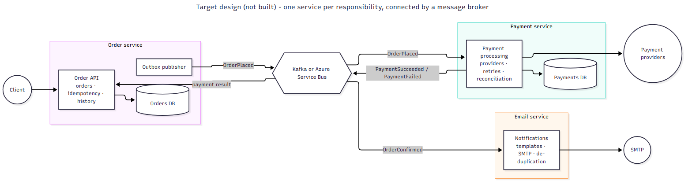

# Background: what this solves and why it is built this way

This page explains the problem, the goals, and the main design decisions with their reasons. For *how* the code is organised, see [architecture.md](architecture.md).

## The starting point

The service began as a single legacy `OrderProcessor` class (the original code is not part of this repository). It was a "god class": validation, pricing, payment, persistence and the confirmation email all lived in one place, and the client sent its own discount with the order.

That shape causes predictable problems in an order system:

| Problem | Why it matters |
|---|---|
| Everything in one class | Hard to read, test or change one part without breaking another |
| Client-supplied discount | Anyone could give themselves any discount |
| Payment and email in one step | A failing email server could fail an order that was already paid for |
| No protection against retries | A client that retries after a timeout could be charged twice |
| No visibility | When something goes wrong in production there is nothing to diagnose it with |

## Goals

1. **Never charge a customer twice**: not on a client retry, not when two identical requests race, and not when the server crashes halfway through a payment.
2. **Never lose an order or a payment outcome**, even if the client disconnects mid-request.
3. **Keep orders and emails independent**: an email outage delays confirmations but never fails orders.
4. **The server decides prices and discounts**, using its own product and promotion data.
5. **Customers only ever see their own orders.** Support staff can see everyone's.
6. **Be easy to understand, test and change**, with the business rules in one place.
7. **Be observable and safe to run**: logs, metrics, traces, health checks, rate limiting, no secrets in the repository.

## How each goal is met

| Goal | Solution | Where |
|---|---|---|
| No double charge on retry | Every order request carries an `Idempotency-Key`. A retry with the same key gets the original result back instead of a new charge. | `PlaceOrderRequestHandler` |
| No double charge when requests race | A unique database index on (customer, idempotency key). The second request is told the first is still in progress (409). | `0002_CREATE_tblOrder.sql` |
| No double charge at the provider | The order id is sent to the payment provider as *its* idempotency key, so charging the same order again is always safe. | `OrderPaymentProcessor` |
| Never lose a payment outcome | The order is saved *before* charging. The charge is not cancelled when the client disconnects, and the outcome is always saved. | `PlaceOrderRequestHandler`, `OrderPaymentProcessor` |
| Recover from a crash mid-payment | A background job finds orders stuck in `PendingPayment` and charges them again with the same provider key, which settles them safely. | `StalledPaymentReconciliationHandler` |
| Orders independent of email | **Transactional outbox**: the "order placed" message is saved in the same database transaction as the order; a background job sends the email and retries on failure. | `OrderPlacedOutboxMessageHandler` |
| Server-side pricing | The request only contains product ids, quantities and an optional promotion code. Prices come from `tblProduct` and the discount from `tblPromotion`. | `PlaceOrderRequestHandler`, `Promotion` |
| Customers see only their own orders | The customer id comes from the login token, never the request body, and is part of every query. | `OrderController`, `OrderRepository` |
| Business rules in one place | The `Order` **aggregate root** is the only way to create or change an order, and it enforces every rule. | `Order.Domain/Entities/Order.cs` |
| Observable | Every log line carries a correlation id; business metrics on `/metrics`; optional OpenTelemetry traces; liveness and readiness checks. | [operations.md](operations.md) |

## Design decisions

Each decision below includes the reason for it, so you can judge whether it still fits if the requirements change.

### One service for now, not microservices
**Decision:** orders, payments and emails live in one solution and one deployable API, separated by layers and interfaces rather than by network boundaries.

**The ideal design.** In a full production system, each responsibility would be its own microservice, connected by a message broker such as **Kafka** or **Azure Service Bus**:

| Service | Owns | Talks to the others by |
|---|---|---|
| **Order service** | Orders, idempotency, order history, its own database | Publishing `OrderPlaced` from its outbox; consuming payment results |
| **Payment service** | Calls to payment providers, retries, reconciliation, its own database | Consuming `OrderPlaced`; publishing `PaymentSucceeded` / `PaymentFailed` |
| **Email service** | Confirmation templates, sending, de-duplication | Consuming `OrderConfirmed` |

Each service could then be deployed, scaled and fail independently: an email outage, or a slow payment provider, would not touch the order service at all.

**Why it was not built that way here.** For the scope of this assignment, three services, a broker and the distributed coordination between them (a saga to keep orders and payments consistent, plus contracts, retries and monitoring for every message) would be over-engineering. They would add a lot of moving parts without changing what the solution needs to prove. So everything stays in one solution, deliberately built so the split is straightforward later:

- **Payments and email are already behind interfaces** (`IPaymentGateway`, `IEmailSender`). The order logic does not know how either works.
- **The outbox already stores a versioned `OrderPlaced` event.** To move to a broker, the outbox job would *publish* that event to Kafka or Azure Service Bus instead of sending the email itself, and the email service would consume it.
- **Payment logic is isolated** in `OrderPaymentProcessor`, `Infrastructure/Payments` and the reconciliation job, which is most of what a payment service would contain.
- **Each part already has its own resilience and metrics**, so the boundaries are visible in monitoring today.

### Onion architecture with four projects
**Decision:** one project per layer (Domain, Application, Infrastructure, Presentation). Dependencies only point inwards.
**Why:** the business rules (Domain) do not depend on databases, HTTP or email, so they are easy to test and cannot be broken by an infrastructure change. One project per *layer* (rather than per concern) keeps the solution small while the compiler still enforces the boundaries. `ArchitectureTests` also fails if a layer references an outer one.

### Commands and queries are handled differently (CQRS-style)
**Decision:** placing an order loads and saves the `Order` aggregate. Reading orders uses lightweight projections straight from the database and never loads the aggregate.
**Why:** writes need the rules; reads need speed and exactly the shape the API returns.

### Save the order before charging
**Decision:** the order is saved as `PendingPayment` first, then charged, then the outcome is saved.
**Why:** the order id must exist to be the provider's idempotency key, and there is always a record that a payment was attempted.

### Idempotency key plus a request fingerprint
**Decision:** the order stores the `Idempotency-Key` and a SHA-256 hash of the (normalised) request.
**Why:** the same key with the *same* request is a retry and gets the original answer. The same key with a *different* request is a client bug and is rejected (422) rather than silently returning the wrong order. Normalising first (items merged and sorted, promotion code upper-cased) means a retry that lists items in another order is still recognised as a retry.

### A payment that failed with a provider error can be retried
**Decision:** if the provider was unreachable (503), a retry with the same key charges the same order again. Declined (402) and duplicate (409) payments are final and are replayed.
**Why:** a provider outage is temporary and the customer was not charged; a decline is a real answer.

### Optimistic concurrency on orders and outbox messages
**Decision:** orders and outbox messages carry a concurrency token that changes on every update. A save based on stale data fails instead of overwriting.
**Why:** several API instances, client retries and background jobs can touch the same row. Locks would be slower and more fragile.

### Transactional outbox for emails
**Decision:** the confirmation is written to the `queueOrderPlaced` table in the same transaction as the payment outcome and sent later by a background job.
**Why:** the order and "we must send an email" are saved together or not at all, and email failures are retried without touching the order.

### Reconciliation job for stalled payments
**Decision:** a background job settles orders stuck in `PendingPayment` for more than 5 minutes by charging them again with the same provider idempotency key.
**Why:** if the server dies between charging and saving the outcome, the customer may have been charged but the order would otherwise stay pending forever. The provider's idempotency means the repeat charge either returns the first charge's result or charges now if the first never arrived.

### SQL scripts own the database schema (not EF migrations)
**Decision:** the schema lives in numbered SQL scripts under `src/dbOrder`, deployed with [grate](https://erikbra.github.io/grate/). Entity Framework only maps to the tables.
**Why:** database changes are reviewed as plain SQL, run the same way locally and in pipelines, and can create the least-privilege login the API uses.

### Keyset paging for order history
**Decision:** the history returns a `nextCursor` to pass back for the next page, instead of page numbers.
**Why:** each page costs the same however deep it is, and new orders arriving while someone is paging do not shift the pages.

### No product cache
**Decision:** only the ordered products are read, by primary key, on each order.
**Why:** prices are always current. A cache can be added if reads ever become a bottleneck, at the cost of briefly stale prices.

### One observability interface
**Decision:** handlers log, record metrics and start traces through `IObservabilityManager` rather than using Serilog, Prometheus and OpenTelemetry directly.
**Why:** application code stays independent of the observability libraries, every log line gets the same format (`Class.Method: message`), and tests can collect metrics easily.

## Improvements made after code review

The solution was reviewed and improved in two rounds. Knowing what changed helps explain some of the code:

| Area | Before | After |
|---|---|---|
| Client disconnects mid-payment | The charge was cancelled, which could leave a paid order stuck as pending | The charge always completes and its outcome is saved |
| Payment provider outage | A retry replayed the 503 forever | A retry charges the same order again, safely |
| Crash between charging and saving | Order stuck in `PendingPayment` | Reconciliation job settles it |
| Validation | Stopped at the first error | Lists every invalid field |
| Limits | None | At most 100 items and 1,000 of each product |
| Order history | Returned everything | Keyset paging |
| Product prices | Cached for an hour | Read on each order |
| Unexpected domain errors | Returned as 400 | Returned as 500 (they are bugs) |
| Metrics | Validation errors counted as failures | Separate `rejected` metric |
| Reading another customer's order | Loaded, then hidden | Filtered in the database query |
| Retry with items in another order | Rejected as a different request | Recognised as the same order |
| Duplicate confirmation emails | Possible after a crash | Same `Message-ID` on every send, so mail clients can de-duplicate |
| Confirmation email content | Order id and total only | Lists every item, the subtotal, the discount and the total |
| Project structure | About 20 projects | 4 projects, one per layer |
| SQL Server integration tests | Failed on a fresh database | Fixed (connection pooling during the first deployment) |

## Known trade-offs

These are deliberate, documented limitations rather than oversights:

- **Emails are sent at least once, not exactly once.** Exactly-once delivery is impossible over SMTP. If the server dies after sending but before recording it, the email is sent again. The stable `Message-ID` lets mail clients that honour it (for example Gmail) show it once.
- **The reconciliation job relies on the payment provider honouring idempotency keys.** If a provider answers a repeated charge with 409 (duplicate) instead of the original result, the order ends up `PaymentFailed / Duplicate` and needs a manual check.
- **Between a crash and reconciliation** (up to about 6 minutes), a client retry for that order gets 409 (in progress).
- **Idempotency keys are kept forever**, on the order row. A retention policy can be added if keys must expire.
- **Order ids are random GUIDs.** Sequential GUIDs would not help, because `tblOrder` is clustered on its `BIGINT` identity.

## Possible next steps

- Split into Order, Payment and Email services connected by Kafka or Azure Service Bus (see [One service for now, not microservices](#one-service-for-now-not-microservices)). A first, low-risk step is to publish the `OrderPlaced` event to the broker from the outbox, so other services can react to orders.
- Add a retention job for old outbox rows and idempotency keys.
- Alert on `payment.reconciled.count` and `outbox.message.pending.count` rising (see [operations.md](operations.md#metrics)).
