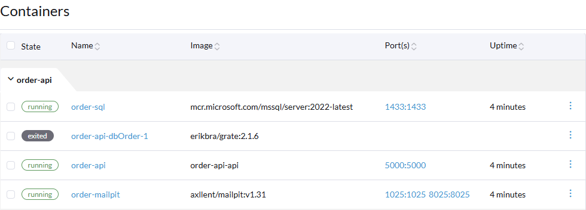
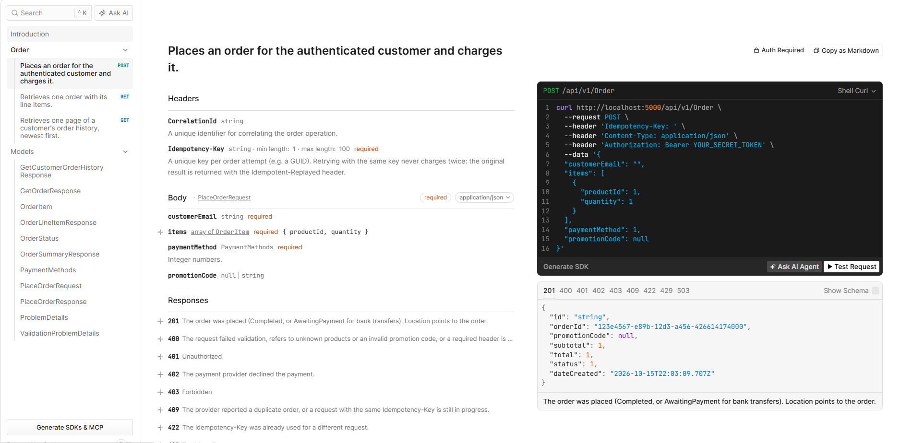
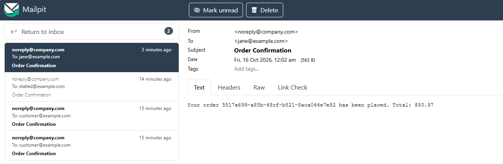

# Running it locally

This guide takes you from a fresh clone to placing an order and seeing its confirmation email. The helper scripts are PowerShell, and the setup has been used on Windows with Docker Desktop or Rancher Desktop.

**On this page:** [Prerequisites](#prerequisites) · [1. Secrets](#1-create-your-local-secrets) · [2. Start](#2-start-the-stack) · [3. Try it](#3-try-it) · [Run the API from your IDE](#run-the-api-from-your-ide-for-debugging) · [Stop and reset](#stop-and-reset) · [Tests](#running-the-tests) · [Troubleshooting](#troubleshooting)

## Prerequisites

| Tool | Why | Check |
|---|---|---|
| [.NET 10 SDK](https://dotnet.microsoft.com/download) | Build, run and test | `dotnet --version` (10.x) |
| [Docker Desktop](https://www.docker.com/products/docker-desktop/) or [Rancher Desktop](https://rancherdesktop.io/) | Runs SQL Server, the database deployment, the mail catcher and the API | `docker info` |
| PowerShell | The helper scripts in `build/local` | `$PSVersionTable` |
| *Optional:* Node.js + `npm install -g @mermaid-js/mermaid-cli` | Re-rendering the diagrams after you edit them | `mmdc --version` |

Make sure Docker is **running** before you start.

## What runs where

| Container | Purpose | Address on your machine |
|---|---|---|
| `order-sql` | SQL Server 2022 (data kept in the `order-sql-data` volume) | `localhost,1433` |
| `order-api-dbOrder-1` | Runs [grate](https://erikbra.github.io/grate/) once to create/update the database from `src/dbOrder`, then exits | – |
| `order-mailpit` | [Mailpit](https://mailpit.axllent.org/), a fake mail server that catches every email | inbox http://localhost:8025 (SMTP `localhost:1025`) |
| `order-api` | The API (only with `--profile api`) | http://localhost:5000 |

Locally, **payment providers are mocked**: every card or PayPal charge succeeds. No real money or provider account is involved.

## 1. Create your local secrets

Nothing secret is stored in the repository. Copy the template:

```powershell
Copy-Item src/.env.example src/.env
```

Open `src/.env` and fill in two passwords:

| Setting | What it is |
|---|---|
| `MSSQL_SA_PASSWORD` | SQL Server's administrator password. Only the database deployment uses it |
| `ORDER_DB_PASSWORD` | Password for `svc_order_api`, the limited login the API connects with |

Both must be at least 8 characters with upper case, lower case, digits and a symbol, and must not contain `;`, `'` or `"`. For example `Local-Sa-Passw0rd!` (any value works locally, as long as it follows those rules).

`src/.env` is git-ignored. Never commit it.

## 2. Start the stack

Every API call needs a login token. This script creates one for customer 42 and copies its signing key into `src/.env`, so the API container trusts it:

```powershell
./build/local/New-LocalToken.ps1 -UpdateEnvFile
```

Copy the token it prints (valid for 8 hours). Then start everything:

```powershell
cd src
docker compose --profile api up -d --build
```

The first run downloads the images and builds the API, which takes a few minutes. Check that it worked:

```powershell
docker compose --profile api ps -a        # sql and mailpit "healthy", dbOrder "Exited (0)", api "Up"
docker compose logs dbOrder               # ends with "Database deployed."
```

and open http://localhost:5000/healthz/ready, which should say `"status":"Healthy"`.

In Docker Desktop or Rancher Desktop the `order-api` group should look like this. `order-api-dbOrder-1` showing **exited** is correct: it deploys the database and stops.



## 3. Try it

### In the browser (easiest)

1. Open **http://localhost:5000/scalar/v1**.
2. Under **Authentication**, choose **Bearer** and paste your token.
3. Open **POST /api/v1/order**, add the headers `CorrelationId` and `Idempotency-Key` (any GUID for each, for example from https://www.uuidgenerator.net), and send this body:

   ```json
   {
     "customerEmail": "jane@example.com",
     "items": [ { "productId": 1, "quantity": 1 }, { "productId": 2, "quantity": 2 } ],
     "paymentMethod": "CreditCard",
     "promotionCode": "WELCOME10"
   }
   ```

   

4. You get **201 Created** with a total of **80.97** (89.97 minus 10%).
5. Within about 10 seconds the confirmation email appears in **http://localhost:8025**:

   

6. Send the same request again with the **same** `Idempotency-Key`: you get the same response with `Idempotent-Replayed: true`, and no second email.

### From PowerShell

```powershell
$token = '<paste your token>'
$headers = @{
    Authorization     = "Bearer $token"
    CorrelationId     = [guid]::NewGuid()
    'Idempotency-Key' = [guid]::NewGuid()
}
$body = '{"customerEmail":"jane@example.com","items":[{"productId":1,"quantity":1}],"paymentMethod":"CreditCard"}'

Invoke-RestMethod -Method Post -Uri http://localhost:5000/api/v1/order -Headers $headers -Body $body -ContentType 'application/json'
Invoke-RestMethod -Uri http://localhost:5000/api/v1/order/by/customer/42 -Headers $headers
```

### From Visual Studio / Rider / VS Code

`src/Order.Presentation.Api/Order.Presentation.Api.http` has ready-made requests. Set `@Host` (`http://localhost:5000` for the container, `http://localhost:5088` for the IDE) and `@Token` at the top.

### Other things to try

| Try | Expect |
|---|---|
| Promotion code `EXPIRED20` or product id `99` | 400 listing the problem |
| `"paymentMethod": "BankTransfer"` | 201 with status `AwaitingPayment` |
| A token for another customer: `./build/local/New-LocalToken.ps1 -CustomerId 7` | Customer 7 gets 404 for customer 42's orders |
| A support token: `./build/local/New-LocalToken.ps1 -Support` | Can read any customer's orders, cannot place orders (403) |
| http://localhost:5000/metrics | Prometheus metrics such as `order_api_place_order_success_count` |

All the request rules and status codes are in [api.md](api.md).

## Run the API from your IDE (for debugging)

Start only the database and mail catcher in Docker, and run the API from Visual Studio, Rider or the command line:

```powershell
cd src
docker compose up -d              # without --profile api: SQL Server, grate and Mailpit only
cd ..
./build/local/Set-LocalSecrets.ps1   # once: copies the API's database login from src/.env into dotnet user-secrets
./build/local/New-LocalToken.ps1     # a token for customer 42
```

Then start `Order.Presentation.Api` with the **`Localhost`** launch profile, or:

```powershell
dotnet run --project src/Order.Presentation.Api --launch-profile Localhost
```

It opens on **http://localhost:5088/scalar/v1**. `appsettings.Localhost.json` points it at the Docker SQL Server and Mailpit and turns on the mock payment providers. Secrets (the database password, the token signing key) come from your dotnet user-secrets, which live in your user profile, outside the repository.

## Stop and reset

```powershell
cd src
docker compose --profile api down        # stop everything, keep the database
docker compose --profile api down -v     # stop everything and delete the database (next start recreates it)
```

After changing code, rebuild the API container with `docker compose --profile api up -d --build`.

## Running the tests

From the repository root:

```powershell
dotnet test                                            # everything
dotnet test --filter "TestCategory!=Integration"       # only the fast tests (no Docker needed)
dotnet test --filter "TestCategory=Integration"        # only the SQL Server tests
```

| Kind | Database | Needs Docker |
|---|---|---|
| Unit and API tests | EF Core in-memory database; background jobs switched off (`IS_TEST=true`) | No |
| SQL Server integration tests | A throwaway SQL Server container (Testcontainers), with the schema deployed by grate exactly as in docker compose | Yes. **Skipped** (not failed) when Docker is not running |

The tests do not use your `src/.env` or the compose stack; they create everything they need. Test login tokens are signed with a random key generated for each run.

CI (`.github/workflows/ci.yml`) runs the same tests on every push and pull request, plus a formatting check (`dotnet format --verify-no-changes`), a vulnerable-package check and a Docker image build. Run `dotnet format` before committing to avoid a formatting failure.

## Changing the database

1. Add a new script to `src/dbOrder/up/` with the next number, for example `0010_ALTER_tblOrder_AddSomething.sql`. **Never edit a script that has already been deployed**: grate stores each script's hash and refuses changes.
2. Update the matching mapping in `src/Order.Infrastructure/Persistence/Mappings`.
3. Apply it locally: `cd src; docker compose up dbOrder` (or `down -v` and start again for a clean database).
4. Run the integration tests: they deploy all scripts to a fresh SQL Server.

## Editing the diagrams

The diagrams in `docs/diagrams` are generated from the `.mermaid` file next to each `.png`. Edit the `.mermaid` file, then run `./build/mermaid/generate-mermaid-png.ps1` (add `-Force` to redraw all of them). A Debug build of the API also redraws any changed diagram if the Mermaid CLI is installed.

## Troubleshooting

| Symptom | Cause and fix |
|---|---|
| `docker compose` says *Set MSSQL_SA_PASSWORD in src/.env* | `src/.env` is missing or the password is empty. See [step 1](#1-create-your-local-secrets) |
| `dbOrder` exits with an error, or `sql` never becomes healthy | Usually a password that breaks SQL Server's rules. Fix it in `src/.env`, then `docker compose --profile api down -v` and start again. `docker compose logs sql` shows the reason |
| *port is already allocated* (1433, 5000, 1025 or 8025) | Something else uses that port, often a local SQL Server on 1433. Stop it, or set `SQL_HOST_PORT` in `src/.env` (and the server in `appsettings.Localhost.json` if you run from the IDE) |
| Every call returns **401** from the container | The container does not have your token's signing key. Run `./build/local/New-LocalToken.ps1 -UpdateEnvFile`, then `docker compose --profile api up -d --force-recreate api` |
| **401** after a few hours | Tokens expire after 8 hours. Create a new one |
| **400** *The CorrelationId header is required* | Add a `CorrelationId` header to every `/api` call |
| **403** when placing an order | You are using a support token, or a token without `customer_id`. Use `New-LocalToken.ps1` without `-Support` |
| PowerShell: *running scripts is disabled on this system* | Run `Set-ExecutionPolicy -Scope CurrentUser RemoteSigned` once |
| No confirmation email in Mailpit | Emails are sent by a background job every 10 seconds, so wait a moment. Check `docker compose logs api` for outbox errors |
| SQL Server integration tests are skipped | Docker is not running |
| The API in the IDE cannot log in to SQL Server | Run `./build/local/Set-LocalSecrets.ps1`, and make sure the compose stack is running |

To look inside the database, connect any SQL client to `localhost,1433` with user `sa` and your `MSSQL_SA_PASSWORD` (tick *Trust server certificate*). The API logs are in `docker compose logs -f api`.
