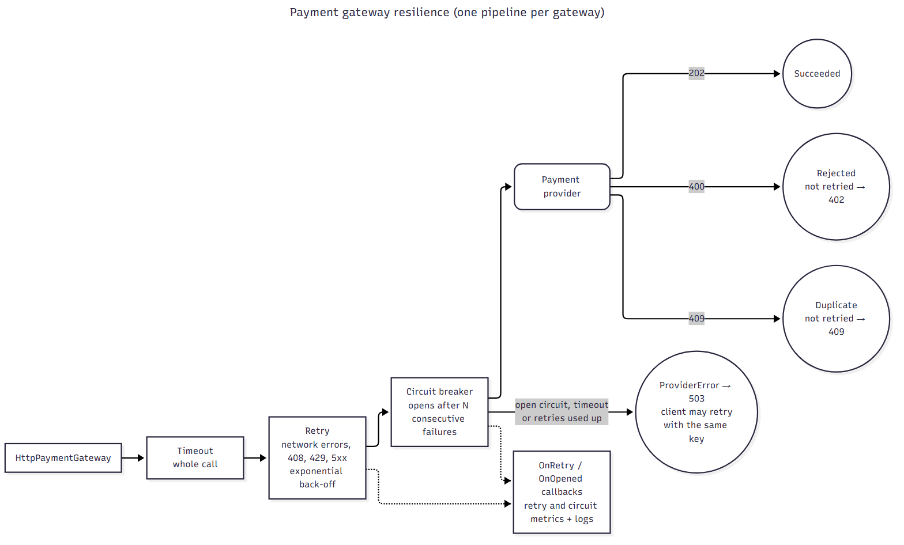

# Operations

How to configure, secure, monitor and deploy the API.

**On this page:** [Configuration](#configuration) · [Security](#security-and-secrets) · [Resilience](#resilience) · [Logs](#logs) · [Metrics](#metrics) · [Traces](#traces) · [Health checks](#health-checks) · [Deployment](#deployment)

## Configuration

Settings live in `src/Order.Presentation.Api/appsettings.json`, with `appsettings.{Environment}.json` on top. Any setting can be overridden by an environment variable, using `__` for each level: `ApplicationConfiguration:Outbox:BatchSize` becomes `ApplicationConfiguration__Outbox__BatchSize`.

| Section (`ApplicationConfiguration:...`) | Setting | Default | Meaning |
|---|---|---|---|
| `Persistence:ApplicationDatabase` | `Server`, `Database`, `Username`, `Password`, `Encrypt` | –, `dbOrder`, –, –, `true` | SQL Server connection. **Password is a secret** |
| `PaymentGateways:Card` / `PayPal` | `BaseUrl` | provider URL | Payment provider endpoint |
| | `ApiKey` | – | **Secret** |
| | `UseMockProvider` | `false` | `true` accepts every charge without calling the provider (local only) |
| | `Timeout` | 30 s | Limit for a whole charge, including retries |
| | `RetryCount`, `RetryBackoffBaseSeconds` | 3, 2 | Retries on network errors, 408, 429 and 5xx, with exponential back-off |
| | `CircuitBreakerFailureThreshold`, `CircuitBreakerDuration` | 5, 30 s | Stop calling a failing provider for a while |
| `Smtp` | `Host`, `Port`, `EnableSsl`, `FromAddress`, `Username`, `Password` | | Mail server. With no `Host`, emails are only logged. **Password is a secret** |
| `Resilience:Email` | `MaxRetryAttempts`, `BaseDelay`, `Timeout` | 3, 1 s, 30 s | Email retries |
| `Outbox` | `PollingInterval`, `BatchSize`, `MaxAttempts`, `LockDuration` | 10 s, 20, 5, 5 min | Confirmation email job. After `MaxAttempts` failures a message stays in the table for investigation |
| `Reconciliation` | `PollingInterval`, `BatchSize`, `StalledPaymentTimeout` | 1 min, 20, 5 min | Stalled payment job. `StalledPaymentTimeout` must be well above the payment `Timeout` |
| `RateLimiting` | `PermitLimit`, `Window` | 60, 1 min | Requests per customer per window on the order endpoints |
| `Observability` | `ApplicationName`, `OtlpEndpoint` | `Order.Api`, empty | Metric name prefix; where to send traces (empty = off) |

Authentication is configured under `Authentication:Schemes:Bearer` (see below). Log levels are under `Serilog:MinimumLevel`.

## Security and secrets

**Nothing secret is committed.** `appsettings*.json` contain no passwords or keys; `src/.env` and user-secrets are outside source control.

| Environment | Where secrets come from |
|---|---|
| Docker compose | `src/.env` (copied from `src/.env.example`) |
| IDE (`Localhost` environment) | dotnet user-secrets, filled by `build/local/Set-LocalSecrets.ps1` and `New-LocalToken.ps1` |
| Deployed | Environment variables injected from the platform's secret store (Kubernetes secrets, Azure Key Vault, ...), for example `ApplicationConfiguration__Persistence__ApplicationDatabase__Password` |

**Authentication.** JWT bearer tokens. In a deployed environment set `Authentication:Schemes:Bearer:Authority` (your identity provider; its signing keys are fetched automatically) and `ValidAudiences`. Issuer, audience, lifetime and signature are always validated, so a missing setting rejects every token rather than accepting any. The API reads two claims: `customer_id` and `role` (`Support`). Claim mapping is off, so these are the raw JWT claim names.

**Least privilege.** The API never connects as `sa`. The database deployment creates `svc_order_api` with read/write access to `dbOrder` only, and sets its password from a deployment variable on every run (so rotating it is a redeploy). If a username is configured without a password, the API refuses to start with a clear message.

**Anonymous endpoints.** `/healthz/*`, `/metrics`, `/openapi` and `/scalar` need no token. Keep `/metrics` (and ideally `/scalar`) on an internal network or behind the ingress in production.

**Other protections.** Per-customer rate limiting (429 with `Retry-After`); errors never expose exception details; encrypted connections to SQL Server (`Encrypt=true`) and to SMTP (TLS required when `EnableSsl` is on).

## Resilience

| Dependency | What happens when it fails |
|---|---|
| **Payment provider** | Per-gateway pipeline: timeout → retry (network errors, 408, 429, 5xx, with back-off) → circuit breaker. 400 and 409 are never retried. Retries are safe because the order id is the provider's idempotency key. If everything fails the client gets 503 and can retry the order with the same `Idempotency-Key` |
| **The API process itself** (crash mid-payment) | The reconciliation job settles the order after `StalledPaymentTimeout` |
| **Email (SMTP)** | MailKit with retry (connection errors and 4xx replies, with back-off and jitter) and a timeout. If it still fails, the outbox retries on a later poll, up to `MaxAttempts`. Orders are never affected |
| **SQL Server** | EF Core's retrying execution strategy for transient errors. The readiness check fails while the database is down, so traffic is moved away |
| **Too many requests** | Fixed-window rate limit per customer → 429 |



## Logs

Serilog writes compact JSON to the console (readable text in the `Localhost` environment). Every line carries the request's `CorrelationId`, so you can follow one request across all its log lines. Messages are written as `{Class}.{Method}: {message}`.

- **Information:** business events: order placed, payment outcome, replays, emails sent.
- **Warning:** declined payments, email failures (retried), stalled payments settled by reconciliation.
- **Error:** unexpected exceptions (the client gets a generic 500).
- **Debug:** "Method started" tracing; off by default. Raise `Serilog:MinimumLevel:Default` to see it.

## Metrics

Prometheus format at `/metrics`. Names are prefixed with the application name, so `place.order.success.count` is exposed as `order_api_place_order_success_count`.

| Metric | Type | Labels | Watch for |
|---|---|---|---|
| `place.order.success.count` | counter | payment_method, order_status | Normal traffic |
| `place.order.failed.count` | counter | payment_method, reason | Declines, provider errors, bugs |
| `place.order.rejected.count` | counter | payment_method, reason | Client mistakes (validation, idempotency); not failures |
| `place.order.replayed.count` | counter | order_status | Client retries |
| `get.order.success.count` / `.failed.count` | counter | reason | |
| `get.customer.order.history.success.count` / `.failed.count` | counter | | |
| `order.total.amount.cents` | counter | payment_method | Revenue |
| `order.lineitem.count` | histogram | payment_method | |
| `payment.charge.count`, `payment.charge.duration.ms` | counter, histogram | gateway, outcome | Provider health and latency |
| `payment.gateway.retry.count`, `payment.gateway.circuit.opened.count` | counter | gateway | **Alert** if the circuit opens |
| `payment.reconciled.count` | counter | order_status | **Alert** if it rises: something is crashing mid-payment |
| `outbox.message.processed.count` / `.failed.count` / `.claim.conflict.count` | counter | reason | |
| `outbox.message.pending.count` | gauge | | **Alert** if it keeps growing: emails are not going out |
| `email.sent.count` / `.failed.count` / `.retry.count` | counter | | |
| `api.request.count`, `api.request.duration.ms` | counter, histogram | endpoint, method, status_code | Traffic, errors and latency per endpoint |
| `api.ratelimit.rejected.count` | counter | | |
| `healthcheck.success.count` / `.error.count` | counter | healthcheck_name | |

## Traces

Set `ApplicationConfiguration:Observability:OtlpEndpoint` to an OpenTelemetry collector to export traces. They include the place-order span (tagged with the order id) and automatic spans for ASP.NET Core requests, outgoing HTTP calls and SQL commands.

## Health checks

| Endpoint | Checks | Use it for |
|---|---|---|
| `/healthz/live` | Only that the process responds | Liveness probe. A database outage does not restart the pod |
| `/healthz/ready` | SQL Server is reachable | Readiness probe. No traffic while the database is unavailable |

Both return JSON, and the results are also published as metrics.

## Deployment

The API is one container; the database is deployed separately by grate before the new version starts.

**1. Deploy the database** (in your pipeline, before the API):

```bash
grate --connstring="Server=<server>;Database=dbOrder;User Id=<admin>;Password=<admin password>;TrustServerCertificate=True;Pooling=false" \
  --sqlfilesdirectory=src/dbOrder --databasetype=sqlserver --version=<build number> \
  --createdatabase=true --transaction=false \
  --ut=AppLogin=svc_order_api --ut=AppLoginPassword=<api password>
```

Leave out `--environment=LOCAL` outside local development, so the `*.ENV.LOCAL.sql` seed scripts do not run. Keep `Pooling=false`: without it a first deployment to an empty server can fail with "Cannot open database".

**2. Build and run the API image:**

```bash
docker build -f build/docker/Dockerfile -t order-api .
```

The image listens on port 5000 and runs as a non-root user. Provide at least:

| Environment variable | Value |
|---|---|
| `ApplicationConfiguration__Persistence__ApplicationDatabase__Server` | SQL Server host |
| `ApplicationConfiguration__Persistence__ApplicationDatabase__Username` / `__Password` | `svc_order_api` and its password |
| `Authentication__Schemes__Bearer__Authority` and `__ValidAudiences__0` | Your identity provider and this API's audience |
| `ApplicationConfiguration__PaymentGateways__Card__ApiKey` (and `PayPal`) | Provider keys |
| `ApplicationConfiguration__Smtp__Host` / `__Username` / `__Password` | Mail server |

Point the liveness and readiness probes at `/healthz/live` and `/healthz/ready`, and let Prometheus scrape `/metrics`. Several instances can run at once: the background jobs coordinate through the database.

**CI.** `.github/workflows/ci.yml` runs on every push to `main` and every pull request: restore, `dotnet format --verify-no-changes`, Release build (warnings are errors), all tests including SQL Server via Testcontainers, a vulnerable-package check, and a Docker image build.
